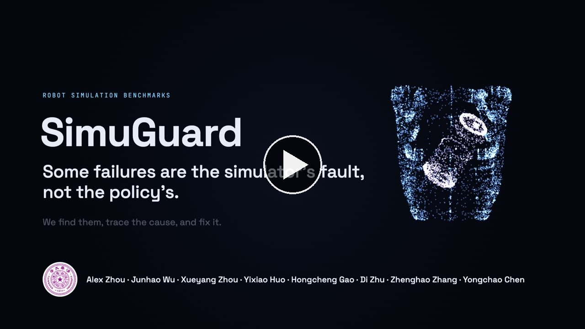
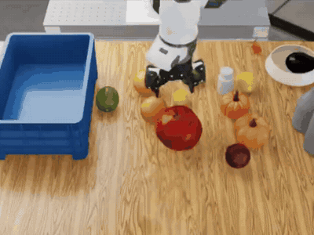
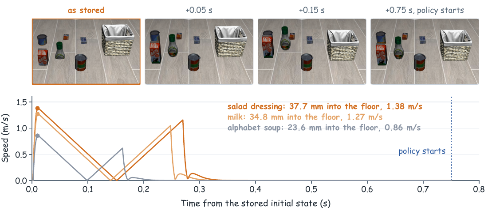

<div align="center">

<h2 align="center">SimuGuard: When the Simulator Fails, Not the Policy<br>Auditing Contact Artifacts in Simulated Robot Benchmarks</h2>

<h2 align="center"><a href="https://simuguard.github.io/">Webpage</a> | <a href="https://arxiv.org/abs/2610.41857">Paper</a> | <a href="https://simuguard.github.io/#film">Video</a> | <a href="docs/results.md">Results</a> | <a href="docs/mechanism.md">Root Cause</a></h2>

<a href="https://simuguard.github.io/#film"></a>

</div>

## News

- **November 25, 2026** — The repository moved to the [simuguard](https://github.com/simuguard) organization, and the project page is now at [simuguard.github.io](https://simuguard.github.io/). Added a step-by-step guide to [repair RoboTwin](#-repair-robotwin).
- **November 22, 2026** — Added RoboLab and RoboDojo, a comparison of five models against a real robot, and two other simulation errors. Updated the [paper](https://arxiv.org/abs/2610.41857) and the video.
- **October 2026** — Released the [SimuGuard paper](https://arxiv.org/abs/2610.41857) and open-sourced the code.

## ✨ Highlights

<table>
<tr>
<td align="center" width="25%"><br><b>RoboTwin 2.0</b><br><sub>SAPIEN · PhysX<br>can thrown out of the basket</sub></td>
<td align="center" width="25%"><br><b>RoboDojo</b><br><sub>Isaac Sim · GPU PhysX<br>tube thrown at 4.31 m/s</sub></td>
<td align="center" width="25%"><br><b>RoboLab</b><br><sub>Isaac Sim · GPU PhysX<br>objects thrown as the gripper comes down</sub></td>
<td align="center" width="25%"><br><b>LIBERO</b><br><sub>MuJoCo<br>mug thrown at 1.57 m/s</sub></td>
</tr>
</table>

<p align="center"><em>An object at rest is thrown in a single physics step, while the robot barely moves. The benchmark records the episode as a failure of the policy.</em></p>

> SimuGuard is an **auditing plugin**. It runs beside the benchmark's own evaluation script and leaves the evaluation unchanged.

- 🔍 **Finds failures caused by the simulator** — flags objects that move faster than the robot or gravity can explain, at every physics step.
- 🌐 **Five benchmarks, two engines** — LIBERO, RoboTwin 2.0, RoboCasa, RoboDojo and RoboLab, on PhysX and MuJoCo.
- 🎞️ **Bit for bit replay** — a recorded episode is reproduced exactly from its seed and controls.
- 🧪 **One parameter reruns** — the same episode runs again with a single simulation parameter changed, which separates the cause from the symptoms.
- 🧭 **Root cause located** — on RoboTwin, a fixed threshold in PhysX's collision detection reports an overlap of about two centimeters between two pieces that do not touch. See [docs/mechanism.md](docs/mechanism.md).
- 🔧 **Repair included** — with a smaller threshold the false contacts disappear, and LingBot-VA rises from 89 to 98 of 100 episodes.
- 🤖 **Closer to the real robot** — in the repaired engine, five models fall into the same order as on a real robot.

SimuGuard also finds two other simulation errors.

<table>
<tr>
<td align="center" width="50%"><br><b>Objects stuck to an open gripper</b><br><sub>RoboLab · flagged in 179 of 4800 episodes</sub></td>
<td align="center" width="50%"><br><b>Objects that start inside their support</b><br><sub>LIBERO · 650 of 2000 stored initial states</sub></td>
</tr>
</table>

## 📊 Results

As released, RoboTwin ranks HyVLA first, although it is fourth on the real robot. In the repaired engine, the five models fall into the same order as on the robot.

| Model | RoboTwin | Repaired | Real robot |
| :-- | :-: | :-: | :-: |
| LingBot-VA | 89/100 | 98/100 | 24/30 |
| InternVLA-A1 | 86/100 | 98/100 | 23/30 |
| HyVLA | 90/100 | 94/100 | 20/30 |
| LingBot-VLA | 82/100 | 95/100 | 21/30 |
| StarVLA | 60/100 | 71/100 | 10/30 |

All tables are in [docs/results.md](docs/results.md).

## 🧩 Supported Benchmarks

| Benchmark | Engine | Entry point |
| :-- | :-- | :-- |
| [RoboTwin 2.0](https://github.com/robotwin-Platform/robotwin) | SAPIEN, PhysX | `simuguard.integrations.robotwin_eval` |
| [RoboDojo](https://github.com/robodojo-benchmark/RoboDojo) | Isaac Sim, PhysX | `simuguard.integrations.robodojo_eval` |
| [RoboLab](https://github.com/NVlabs/RoboLab) | Isaac Sim, PhysX | `simuguard.integrations.robolab_eval` |
| [LIBERO](https://github.com/Lifelong-Robot-Learning/LIBERO) | MuJoCo | `simuguard.adapters.mujoco` |
| [RoboCasa](https://github.com/robocasa/robocasa) | MuJoCo | `simuguard.adapters.mujoco` |

A new benchmark needs an adapter that implements `simuguard.core.adapter.SimAdapter`.

## 🚀 Quick Start

Attach SimuGuard to a RoboTwin environment:

```python
from simuguard import MonitorConfig, SubstepMonitor, EpisodeRecorder, default_detectors
from simuguard.adapters.robotwin import RoboTwinAdapter, make_task_env

env, _ = make_task_env("/path/to/RoboTwin", "place_can_basket", seed=100000)
adapter = RoboTwinAdapter(env)                       # roles: can=target, basket=container
monitor = SubstepMonitor(
    adapter,
    default_detectors(ejection_gate=adapter.containment_gate()),
    episode_id="place_can_basket-100000",
    config=MonitorConfig(snapshot_interval_substeps=100),
    recorder=EpisodeRecorder("runs/place_can_basket-100000"),
)
monitor.attach()
# ... run the policy / evaluator loop unchanged (env.take_action(...)) ...
summary = monitor.finalize()          # events, bundles, needs_human_review
```

To run the official RoboTwin evaluator with SimuGuard attached:

```bash
python -m simuguard.integrations.robotwin_eval \
    --robotwin-root /path/to/RoboTwin --simuguard-out runs/eval_place_can_basket \
    -- --bench_name RoboTwin --task_name place_can_basket --env_cfg_type aloha_agilex \
       --policy_name LingBot_VA --host 127.0.0.1 --port <bridge port> --protocol ws \
       --eval_batch false --seed 0 --test_num 10 --instruction_type seen --expert_check true
```

## 🔧 Repair RoboTwin

RoboTwin 2.0 runs on SAPIEN 3.0.0b1. The repair changes the threshold in a copy of SAPIEN's
library; the installed package is left as it is.

```bash
SP=$(python -c "import sapien, os; print(os.path.dirname(os.path.dirname(sapien.__file__)))")
SITE=/path/to/sapien_patched/site
mkdir -p $SITE && cp -r $SP/sapien $SP/sapien.libs $SITE/
python scripts/mechanism/sapien_patch/patch_lib.py \
    $SP/sapien.libs/libsapien.so $SITE/sapien.libs/libsapien.so $SITE/patch_log.json
```

The script checks every byte it expects before it writes, and prints `patched 4 sites`.
To evaluate in the repaired engine, point SimuGuard at the copy and add one flag to the
command above:

```bash
export SIMUGUARD_PATCHED_SAPIEN=$SITE
python -m simuguard.integrations.robotwin_eval --sim-intervention gjk_fix \
    --robotwin-root /path/to/RoboTwin --simuguard-out runs/eval_repaired -- <evaluator arguments>
```

## 📚 Documentation

| Document | Description |
| :-- | :-- |
| [Setup](docs/SETUP.md) | Environment setup for RoboTwin with LingBot-VA, in Chinese. |
| [Details](docs/DETAILS.md) | Replay, reruns, output files and validation runs. |
| [Root Cause](docs/mechanism.md) | Where the RoboTwin contact artifacts come from, with the evidence at each level. |
| [Results](docs/results.md) | All result tables. |
| [Architecture](docs/ARCHITECTURE.md) | Recorder, detectors, replay and adapters. |
| [RoboDojo](docs/robodojo.md) | Notes on the RoboDojo integration. |
| [LIBERO](docs/libero.md) | Notes on the LIBERO integration. |

## 🗂️ Repository Structure

```text
simuguard/core/           recorder, detectors, replay; depends only on numpy
simuguard/adapters/       robotwin, isaac for RoboDojo and RoboLab, mujoco for LIBERO and RoboCasa
simuguard/integrations/   wrappers around each benchmark's own evaluator
scripts/                  campaigns and analysis for each benchmark
scripts/mechanism/        the PhysX threshold: reproduction and patch
docs/                     notes and result tables
tests/                    unit tests with a toy adapter
```

Run the unit tests with:

```bash
PYTHONPATH=.:tests python -m unittest discover -s tests
```

## 📝 Citation

```bibtex
@article{zhou2026simuguard,
  title   = {When the Simulator Fails, Not the Policy:
             Auditing Contact Artifacts in Simulated Robot Benchmarks},
  author  = {Zhou, Alex and Wu, Junhao and Zhou, Xueyang and Huo, Yixiao and
             Gao, Hongcheng and Zhu, Di and Zhang, Zhenghao and Chen, Yongchao},
  journal = {arXiv preprint arXiv:2610.41857},
  year    = {2026}
}
```

## 🙏 Acknowledgements

SimuGuard builds on [LIBERO](https://github.com/Lifelong-Robot-Learning/LIBERO), [RoboTwin 2.0](https://github.com/robotwin-Platform/robotwin), [RoboCasa](https://github.com/robocasa/robocasa), [RoboDojo](https://github.com/robodojo-benchmark/RoboDojo), [RoboLab](https://github.com/NVlabs/RoboLab), [SAPIEN](https://github.com/haosulab/SAPIEN), [MuJoCo](https://github.com/google-deepmind/mujoco) and [Isaac Sim](https://developer.nvidia.com/isaac/sim). We thank the authors and maintainers for their open-source contributions to the robotics community.

## 🏫 Affiliations

College of AI, Tsinghua University.

## ⚖️ License

Released under the [MIT License](LICENSE).

<p align="center">
  &nbsp;
  &nbsp;
  &nbsp;
  &nbsp;
  
</p>
