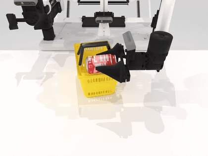
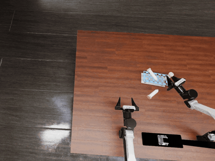
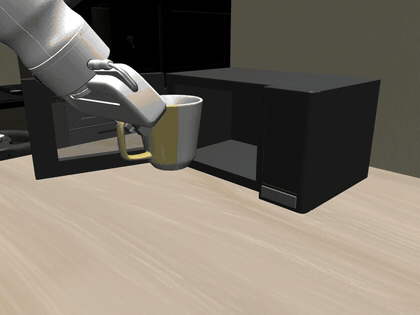
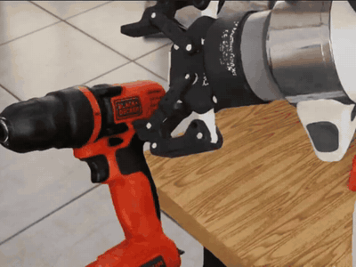

<div align="center">

<h1>SimuGuard</h1>

<h3>Some failures in robot simulation benchmarks are the simulator's fault, not the policy's.<br>SimuGuard finds them, traces the cause, and fixes it.</h3>

<h4>
<a href="https://alexander22568.github.io/simuguard/">Project Page</a> &nbsp;|&nbsp;
<a href="https://alexander22568.github.io/simuguard/#film">Video</a> &nbsp;|&nbsp;
<a href="https://arxiv.org/abs/2610.41857">Paper</a> &nbsp;|&nbsp;
<a href="#quick-start-robotwin">Quick Start</a> &nbsp;|&nbsp;
<a href="docs/results.md">Results</a> &nbsp;|&nbsp;
<a href="docs/mechanism.md">Root Cause</a>
</h4>

<a href="https://alexander22568.github.io/simuguard/#film"></a>

</div>

SimuGuard is an auditing plugin for simulated robot benchmarks. It runs beside the
benchmark's own evaluation script, records every physics step, and flags objects that move
faster than the robot or gravity can explain. It supports LIBERO, RoboTwin, RoboCasa,
RoboDojo and RoboLab.

## What it finds

An object at rest is thrown in a single physics step, while the robot barely moves.

<table>
<tr>
<td align="center" width="25%"><br><b>RoboTwin 2.0</b><br><sub>SAPIEN · PhysX<br>can thrown out of the basket</sub></td>
<td align="center" width="25%"><br><b>RoboDojo</b><br><sub>Isaac Sim · GPU PhysX<br>tube thrown at 4.31 m/s</sub></td>
<td align="center" width="25%"><br><b>RoboLab</b><br><sub>Isaac Sim · GPU PhysX<br>objects thrown as the gripper comes down</sub></td>
<td align="center" width="25%"><br><b>LIBERO</b><br><sub>MuJoCo<br>mug thrown at 1.57 m/s</sub></td>
</tr>
</table>

It also finds two other simulation errors.

<table>
<tr>
<td align="center" width="50%"><br><b>Objects stuck to an open gripper</b><br><sub>RoboLab · flagged in 179 of 4800 episodes</sub></td>
<td align="center" width="50%"><br><b>Objects that start inside their support</b><br><sub>LIBERO · 650 of 2000 stored initial states</sub></td>
</tr>
</table>

## Main results

* **Cause.** On RoboTwin, a fixed threshold in PhysX's collision detection makes the engine
  report an overlap of about two centimeters between two pieces that do not touch. The solver
  removes the overlap in one step and throws the object out. See [docs/mechanism.md](docs/mechanism.md).
* **Repair.** With a smaller threshold the false contacts disappear. On five container tasks,
  LingBot-VA rises from 89 to 98 of 100 episodes, and no episode has an artifact.
* **Ranking against a real robot.** As released, RoboTwin ranks HyVLA first, although it is
  fourth on the real robot. In the repaired engine, five models fall into the same order as on
  the robot.

| Model | RoboTwin | Repaired | Real robot |
|---|---|---|---|
| LingBot-VA | 89/100 | 98/100 | 24/30 |
| InternVLA-A1 | 86/100 | 98/100 | 23/30 |
| HyVLA | 90/100 | 94/100 | 20/30 |
| LingBot-VLA | 82/100 | 95/100 | 21/30 |
| StarVLA | 60/100 | 71/100 | 10/30 |

All tables are in [docs/results.md](docs/results.md).

## How it works

1. **Record.** State, controls and contacts at every physics step. The evaluation is unchanged.
2. **Detect.** A contact that starts motion, then a gravity check, then a carrier check.
3. **Replay.** A recorded episode is reproduced bit for bit from its seed and controls.
4. **Rerun.** The same episode runs again with one simulation parameter changed.

## Supported benchmarks

| Benchmark | Engine | Entry point | Notes |
|---|---|---|---|
| RoboTwin 2.0 | SAPIEN, PhysX | `simuguard.integrations.robotwin_eval` | [docs/DETAILS.md](docs/DETAILS.md) |
| RoboDojo | Isaac Sim, PhysX | `simuguard.integrations.robodojo_eval` | [docs/robodojo.md](docs/robodojo.md) |
| RoboLab | Isaac Sim, PhysX | `simuguard.integrations.robolab_eval` | [docs/DETAILS.md](docs/DETAILS.md) |
| LIBERO | MuJoCo | `simuguard.adapters.mujoco` | [docs/libero.md](docs/libero.md) |
| RoboCasa | MuJoCo | `simuguard.adapters.mujoco` | `scripts/robocasa/` |

A new benchmark needs an adapter that implements `simuguard.core.adapter.SimAdapter`.

## Quick start (RoboTwin)

```python
from simuguard import MonitorConfig, SubstepMonitor, EpisodeRecorder, default_detectors
from simuguard.adapters.robotwin import RoboTwinAdapter, make_task_env

env, _ = make_task_env("/path/to/RoboTwin", "place_can_basket", seed=100000)
adapter = RoboTwinAdapter(env)                       # roles: can=target, basket=container
monitor = SubstepMonitor(
    adapter,
    default_detectors(ejection_gate=adapter.containment_gate()),
    episode_id="place_can_basket-100000",
    config=MonitorConfig(snapshot_interval_substeps=100),
    recorder=EpisodeRecorder("runs/place_can_basket-100000"),
)
monitor.attach()
# ... run the policy / evaluator loop unchanged (env.take_action(...)) ...
summary = monitor.finalize()          # events, bundles, needs_human_review
```

To run the official RoboTwin evaluator with SimuGuard attached:

```bash
python -m simuguard.integrations.robotwin_eval \
    --robotwin-root /path/to/RoboTwin --simuguard-out runs/eval_place_can_basket \
    -- --bench_name RoboTwin --task_name place_can_basket --env_cfg_type aloha_agilex \
       --policy_name LingBot_VA --host 127.0.0.1 --port <bridge port> --protocol ws \
       --eval_batch false --seed 0 --test_num 10 --instruction_type seen --expert_check true
```

Replay, reruns, output files and validation runs are described in [docs/DETAILS.md](docs/DETAILS.md).
Environment setup is in [docs/SETUP.md](docs/SETUP.md).

## Repository layout

```
simuguard/core/           recorder, detectors, replay; depends only on numpy
simuguard/adapters/       robotwin, isaac (RoboDojo, RoboLab), mujoco (LIBERO, RoboCasa)
simuguard/integrations/   wrappers around each benchmark's own evaluator
scripts/                  campaigns and analysis for each benchmark
scripts/mechanism/        the PhysX threshold: reproduction and patch
docs/                     notes, result tables, project page
tests/                    unit tests with a toy adapter
```

```bash
PYTHONPATH=.:tests python -m unittest discover -s tests
```

## Citation

```bibtex
@article{zhou2026simuguard,
  title   = {When the Simulator Fails, Not the Policy:
             Auditing Contact Artifacts in Simulated Robot Benchmarks},
  author  = {Zhou, Alex and Wu, Junhao and Zhou, Xueyang and Huo, Yixiao and
             Gao, Hongcheng and Zhu, Di and Zhang, Zhenghao and Chen, Yongchao},
  journal = {arXiv preprint arXiv:2610.41857},
  year    = {2026}
}
```
